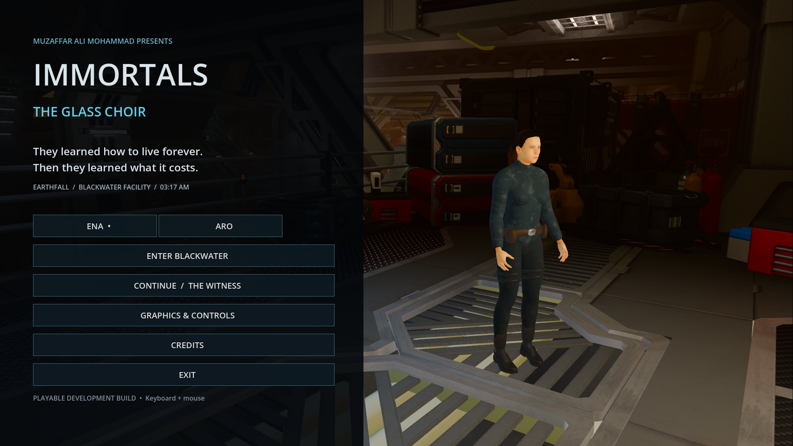
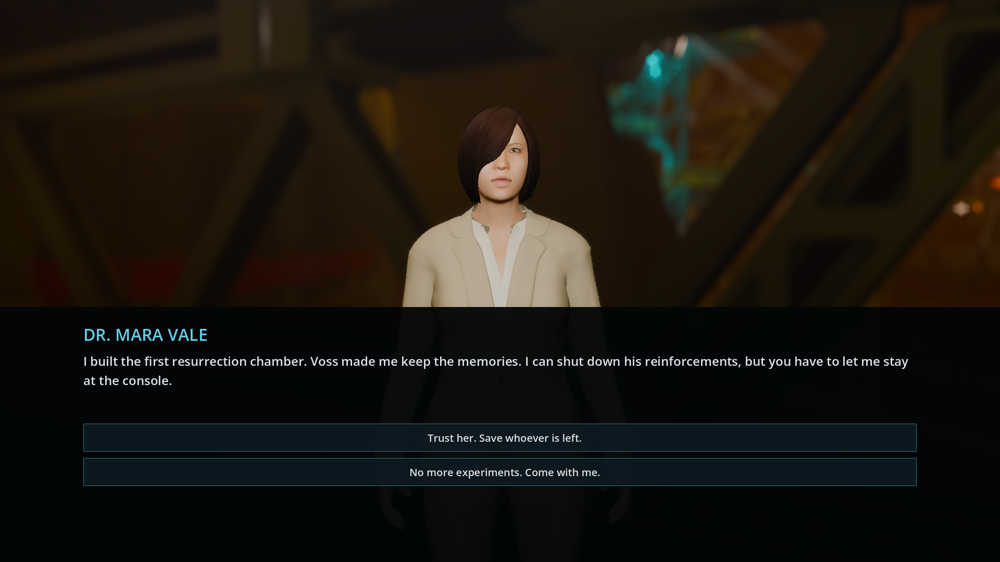
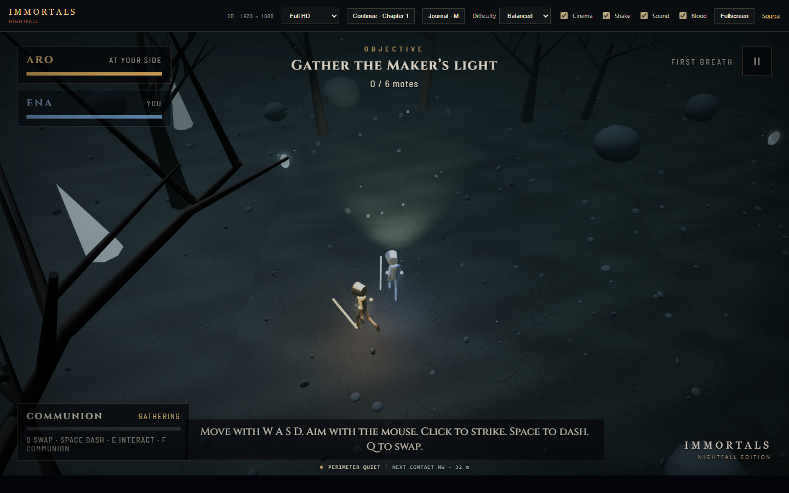

# Immortals: Genesis to Ruin — Nightfall

A free, open-source survival-action game about Aro and Ena, two immortals who journey from the first morning to the end of creation—and back again. Available as a **downloadable Godot PC alpha** and a browser prototype.

**[Download The Glass Choir for Windows](https://github.com/Muzaffar-07/immortals-genesis-to-ruin/releases/tag/v0.5.0-cinematic)** · [Play the browser prototype](https://immortals-genesis-to-ruin.vercel.app) · [Source on GitHub](https://github.com/Muzaffar-07/immortals-genesis-to-ruin)

The native version, **The Glass Choir**, follows Aro or Ena into Blackwater: an industrial facility harvesting immortality. Version 0.5 adds detailed principal characters, 27 generated voice clips, skippable cinematic close-ups, facial speech motion, and a rebuilt jab/cross/hook chain. It includes rigged human characters, animated combos, parries, blink strikes, gravity pulls, time fracture, guards, a phased villain fight, evidence, conversations, consequential choices, checkpoints, recorded spatial sound and a score. The authored Godot TPS environment and MakeHuman/Ara character pipeline are credited under their original licenses. Full HD is the default; 4K supersampling is optional. Open `native/project.godot` in Godot 4.7.2. See the [native README](native/README.md) for controls, validation and limitations. This is a playable development slice, not a finished AAA or PS5 production.





The following sections describe the **browser version**.

Nightfall adds 3D playable environments at 1920 × 1080, animated skinned characters, shadowed terrain, atmospheric fog, weather, glowing particles, horror audio, optional blood and remains, and cinematic 2D interludes. All six chapters are available from the title screen. This is an independent browser prototype with stylized 3D visuals, not a photorealistic AAA or PS5 production.



## Play locally

Requires Node.js 20 or newer. No build step. The browser's Three.js modules and character asset are bundled locally, so a CDN is not required. WebGL2 is used for the 3D renderer; an older Canvas renderer is available as a compatibility fallback.

```sh
npm start
```

Open http://localhost:4173 in a modern desktop browser. Use a keyboard and mouse. Click the game to focus keyboard input.

| Input | Action |
| --- | --- |
| WASD / arrow keys | Move |
| Mouse | Aim |
| Left click / J | Strike |
| Space / Shift | Dash |
| Q | Swap Aro (melee) and Ena (ranged) |
| E (hold) | Interact |
| F | Communion, when charged |
| P | Pause / resume |
| M | Open the mission journal |

Choose Story, Balanced, or Relentless difficulty. Full HD uses a 1920 × 1080 rendering buffer and dynamic shadows. Performance uses 1280 × 720 and disables shadows. The image scales to fit the window. Toggle cinematic exposure, screen shake, synthesized sound, and blood effects in the toolbar. Audio begins after a click or keypress. A fallen character revives after five seconds; losing both characters or a mission objective ends the attempt.

The journal contains chapter-specific survival intelligence. Three optional forbidden memories appear in each mission: hold E nearby to collect one and restore 25 Communion. The field display provides a bearing and distance to the next main contact. Chapter checkpoints and completed chapters are saved in this browser's local storage. Continue restarts the saved chapter; it does not restore an in-progress fight.

## Chapters

1. **First Breath / The Woods Remember** — Recover six fragments in a dead forest, then survive two attacks.
2. **The First Flame / Do Not Let It Go Out** — Find flint and wood, ignite the hearth, and defend the flame for 75 seconds.
3. **The Long Ages / The Bells of the Dead** — Protect the Beacon through three escalating historical assaults.
4. **Earthfall / No Witnesses** — Destroy three containment pylons, survive the armored response, and return to your vessel.
5. **The Dying Stars / Seven Heartbeats** — Recover seven seeds and reach the rift before the 150-second collapse.
6. **The End of Making / The Thing at the End** — Survive the Unmaking's three attack phases and open a door through time.

## Tests

```sh
npm ci
npm test
npx playwright install chromium
npm run test:browser
```

The simulation test exercises all six chapter win paths on Story and Relentless, rebirth, the epilogue, and failure/retry paths. It uses a scripted player with assisted objective completion and survival, so it does not establish gameplay balance. The browser test starts its own local server and checks 3D initialization at Full HD, character loading, the mission journal, chapter entry, input, pause/resume, and responsive sizing. It then uses Performance graphics for software-rendered CI. Screenshots go to `test-results/`.

An optional GitHub Actions workflow is provided in `docs/github-actions-test.yml`. To enable CI, copy it to `.github/workflows/test.yml` using a GitHub credential with workflow permission.

## Hosting

Serve the `public/` directory with any static web host. `vercel.json` configures Vercel's output directory. No backend, API keys, database, or Claude account is required. Google Fonts is optional; system fonts are used if it is unavailable.

## Source

- `public/game.js`: original game logic and fallback rendering.
- `public/world3d.js`: Three.js terrain, characters, lighting, animation, and effects.
- `public/experience.js`: mission journal, optional objectives, audio, chapter saves, and renderer integration.
- `public/index.html`: screens and HUD templates.
- `public/runtime.js`: standalone property-binding renderer replacing the artifact host.
- `public/app.js` and `public/site.css`: browser startup, settings, fullscreen and scaling.
- `tests/`: simulation and browser checks.

The concept was created by Muzaffar Ali Mohammad. The initial game was developed with Claude as **Immortals: Genesis to Ruin**, then adapted and expanded with Codex for standalone hosting. No proprietary artifact runtime is bundled. Environments, effects, and sound are procedural. Animated character geometry uses the credited Cesium Man asset with replacement materials and fantasy equipment.

Current limitations: no touch/gamepad controls, voice acting, mid-mission saves, or multiplayer. Actual frame rate depends on the GPU; Full HD specifies resolution rather than a guaranteed frame rate. Contributions improving accessibility, performance, controls, balance, and audio are welcome. Please describe changes and run relevant tests in pull requests. Do not commit secrets or assets you cannot redistribute.

## License

Game code: MIT. See [LICENSE](LICENSE). Three.js: MIT, with its notice in `public/vendor/THREE-LICENSE.txt`. Character asset: CC BY 4.0, copyright Cesium. See [asset attribution](public/assets/ATTRIBUTION.md) for the source, changes, and license. The asset's separate license must be preserved when redistributing it.
