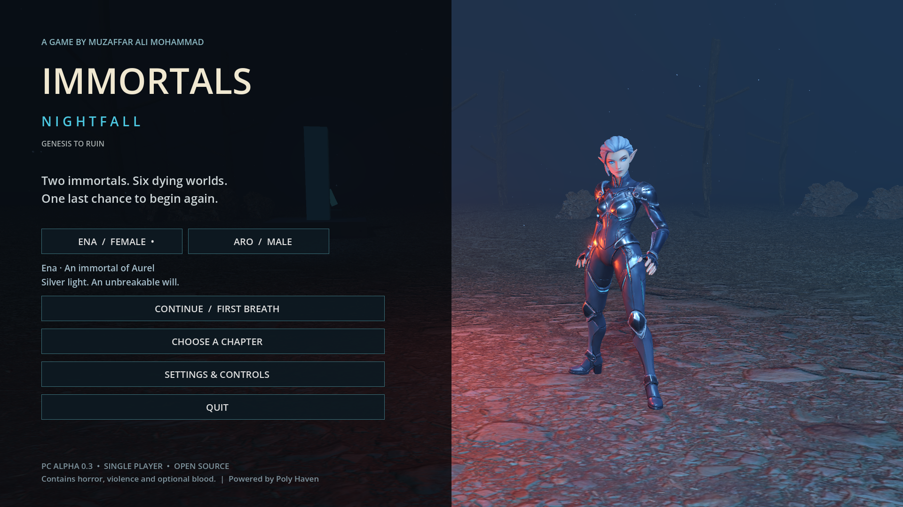

# Immortals: Nightfall — native PC alpha

A downloadable single-player Godot game following Aro and Ena through six ages.
This version adds original textured and rigged male/female characters generated
with Higgsfield, scanned PBR terrain and environmental props, third-person camera,
recorded positional sound effects, combat and dodging, optional blood, mission
journal, and chapter checkpoints. It is an early independent PC alpha, not a
finished AAA game or PlayStation release.



## Play

Download `Immortals-Nightfall-Windows-x64.zip` from
https://github.com/Muzaffar-07/immortals-genesis-to-ruin/releases/tag/v0.3.0-pc-alpha
and extract the entire folder before running `Immortals.exe`. Keep `Immortals.pck`
beside it. No installation, login, service, or internet connection is required.
The executable is unsigned. Windows may show a publisher warning.

Windows x64; keyboard and mouse; Vulkan-capable graphics for the Forward+ renderer.
`Launch-Compatibility.cmd` uses OpenGL 3.3 if Vulkan is unavailable. Full HD renders at 1920×1080; Performance renders the 3D
scene at roughly 1280×720. A GTX 1650 Ti was used for rendering checks; this is not
a broad hardware benchmark or a guaranteed frame rate. Fullscreen is in Settings.

| Input | Action |
|---|---|
| WASD / mouse | Move / look |
| Shift / Space | Sprint / invulnerable dodge |
| Left click | Aim-assisted energy strike (28 m range) |
| F | Communion: area damage and healing, when charged |
| E | Collect, activate, or exit |
| M / Escape | Mission journal / pause |

An orange ring warns of an attack. Dodge out before it lands. Killing enemies
and recovering objectives restore some health. Communion regenerates and charges
with successful strikes. Both protagonists have identical gameplay statistics.
Difficulty changes incoming damage. Blood can be disabled in Settings.

## Campaign

1. **First Breath**: recover three fragments and survive two assaults.
2. **The First Flame**: recover flint and deadwood, ignite a hearth, defend it for 75 seconds.
3. **The Long Ages**: activate and protect the Beacon through three assaults.
4. **Earthfall**: sabotage three pylons and defeat the response force.
5. **The Dying Stars**: recover seven seeds and escape a meteor storm in 180 seconds.
6. **The End of Making**: defeat the Unmaking's three forms and open the time door.

All chapters can be selected from the title menu. Progress is stored in Godot's
per-user application data directory (`nightfall-save.json`). Continue restarts
the current chapter; there is no mid-mission snapshot.

## Run or edit the source

Import `project.godot` in Godot 4.7.2, then press F6/F5. Assets are bundled; an AI
subscription is not needed. The engine can be obtained at https://godotengine.org/.

```powershell
godot --headless --path native --editor --import
godot --headless --path native -- --smoke
godot --path native
```

`--smoke` checks all six mission completion paths with both characters, character
animation loading, health failure, sanctuary loss, timer failure, pause/resume,
movement, aiming, dodge protection and Communion healing.
It assists combat/objectives and does not establish balance. It never writes the
player's save. `--capture` saves title and gameplay PNGs under `test-output/` and
exits. Neither test mode is needed for normal play.

For a Windows export, install matching Godot export templates. The build script
`../tools/build-native.ps1` can use the official Windows release template in
`../tools/bin/windows_release_x86_64.exe`. It writes an ignored local export
preset and packages the executable, data file and license notices under `build/`.

## Known alpha limitations

- Small arena environments with repeated props; no open-world traversal.
- Limited animation set; energy combat, no motion-captured melee choreography.
- Recorded foley plus pitched bell ambience; no dialogue or original score.
- Generated characters need further artist cleanup; enemies reuse corrupted rigs.
- No multiplayer, controller input, remappable keys, or console certification.
- Horror blood effects are stylized; no dismemberment system.

Contributions to animation, environmental art, enemy variety, accessibility,
missions and performance are welcome. Code is MIT. Preserve the asset licenses
and provenance in [assets/ATTRIBUTION.md](assets/ATTRIBUTION.md).
